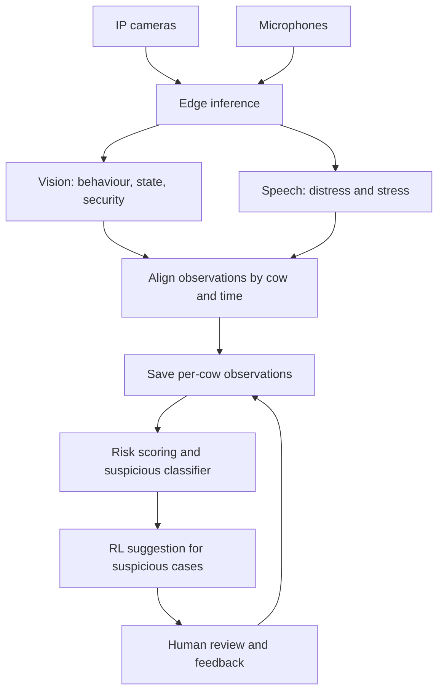

# FarmPulse AI

FarmPulse AI is a proposed cow monitoring system. It uses camera and microphone data to create a time-stamped record for each cow, identify changes in behaviour or vocalisation, estimate health risk, and suggest a response for a farmer or veterinarian to review.

The first milestone is a reproducible prototype: collect and label a small dataset, train baseline perception models, store cow-level observations, and demonstrate an alert from an end-to-end test. The risk classifier and reinforcement learning (RL) decision module require verified outcomes and feedback before their performance can be evaluated.

## Project idea

Repeated observations can reveal changes that are easy to miss during periodic checks. FarmPulse AI brings video and audio observations together by cow ID and time, stores the resulting records, and uses their history to flag cows that may need attention. The system supports human decisions; a risk score or suggested action is not a diagnosis.

## Scope

### In scope

- Detect cow behaviour and visible state from video, including movement, feeding, posture, and observable signs such as an open mouth.
- Classify relevant vocalisations or distress sounds from audio.
- Associate observations with a cow and a timestamp, then save a record for each cow.
- Use current and historical records to estimate a defined health risk and trigger an alert when a reviewed threshold is crossed.
- Route possible intruders to a separate immediate security alert.
- Produce a weekly summary and show cow risk, stressed/suspicious counts, and reports on a dashboard.
- Collect farmer or veterinarian feedback on alerts and outcomes to improve later versions.
- Explore an RL policy for recommending responses once suitable outcome data and a safe evaluation process exist.

### Outside the initial prototype

- Autonomous treatment, medication, or veterinary diagnosis.
- A claim that illness or death can be predicted accurately before labeled outcomes and a held-out evaluation exist.
- Deployment across multiple farms, fully automated cow identification, or a production-grade dashboard.

## System architecture

The project has four main modules:

| Module | Input | Output | Responsibility |
| --- | --- | --- | --- |
| **1. Vision** | Camera clips | Cow ID or track, behaviour and state labels, security event, confidence, time | Run behaviour (CV-M1), visible state (CV-M2), and security/intruder (CV-M3) detectors. |
| **2. Speech** | Microphone clips and a matched visual event | Sound label, stress flag, confidence, time and zone | Classify distress sounds (SP-M1); combine a sound with a visible open mouth when reliable to strengthen a stress indication. |
| **3. Analytics and prediction** | Vision and speech outputs; prior records | Per-cow records, risk score, suspicious flag, alerts | Align and store observations first; then score risk with rules and, when labeled outcomes exist, train a supervised classifier. |
| **4. RL decision support** | Suspicious case, cow history, risk estimate, feedback | Suggested action and policy evaluation | Evaluate approved response options and propose one for a person to review. |



**Record flow:** The vision and speech models produce observations after inference. The analytics service aligns them by cow, location, and time, creates a record for each cow and observation interval, and saves it. Risk scoring and the suspicious classifier then read those records to flag possible illness or another precisely defined outcome. Suspicious cases can be passed to the RL service for a reviewed action suggestion. When a microphone covers multiple cows, the sound remains a zone-level observation unless attribution to one cow is justified. The proposed fusion rule sets `stressed=true` when a time-matched distress sound and an open mouth occur together; the raw sound observation is still recorded when the mouth is not visible.

**Other paths shown in the low-level design:** A possible intruder from CV-M3 triggers an immediate security alert. A high health-risk score triggers an alert to the farmer or veterinarian. A scheduled job reads the previous seven days of observations, builds a weekly report, stores it, and makes it available on the dashboard. These paths use an application/API layer for routing, storage, alerts, and reporting; model inference runs in separate services.

| Proposed logical data store | Purpose |
| --- | --- |
| `cow_profiles` | Cow identity and latest summarized risk. |
| `cow_observations` | Time-stamped vision/audio records and associated predictions. |
| `weekly_reports` | Aggregated weekly findings for the dashboard. |

Example observation record (illustrative schema):

```json
{
  "farm_id": "farm-01",
  "cow_id": "C104",
  "observed_at": "2026-09-26T18:00:00Z",
  "zone": "feeding-area",
  "vision": {
    "behaviour": "walking",
    "state": ["mouth_open"],
    "confidence": 0.88
  },
  "audio": {
    "label": "distress",
    "confidence": 0.76,
    "attribution": "zone"
  },
  "source_refs": ["camera-03/clip-001", "mic-02/clip-008"]
}
```

Scores, alerts, human feedback, and later clinical outcomes should be stored separately from the raw observation so it remains clear what was measured, predicted, and confirmed.

## Proposed project tasks

### 1. Define the problem and data contract

- [ ] Choose the first target outcome, its prediction window, and its ground-truth source (for example, a veterinarian-confirmed condition within the next 24 hours).
- [ ] Define cow IDs, camera/microphone zones, timestamps, observation records, outcome labels, and feedback fields.
- [ ] Decide how to handle a cow that cannot be identified and audio that cannot be assigned to one cow.
- [ ] Agree with farm staff on acceptable alerts and permitted response options.

### 2. Collect and label data

- [ ] Capture timestamped video and audio with farm, device, and zone metadata.
- [ ] Record cow identity where reliable; retain uncertain cases as unassigned.
- [ ] Write a labeling guide for behaviour, visible state, sound, and verified health outcomes.
- [ ] Label an initial dataset and review a subset with a second annotator or domain expert.
- [ ] Secure and back up raw media; keep a manifest of clips and labels.

### 3. Prepare and inspect the dataset

- [ ] Clean corrupt clips, align device clocks, and handle missing or noisy data.
- [ ] Split train/validation/test sets by cow and collection period to reduce leakage; keep the test set untouched during model selection.
- [ ] Inspect class balance, night footage, occlusion, multiple cows, silence, and background noise.
- [ ] Make preprocessing reproducible with scripts and dataset version information.

### 4. Build baseline vision and audio models

- [ ] Start with a small set of well-defined behaviour and visible-state labels.
- [ ] Add a security/intruder detector and route its events separately from health observations.
- [ ] Train or adapt a baseline model for video and a baseline classifier for sound.
- [ ] Test how the mouth-open state and a time-matched vocalisation contribute to a stress flag.
- [ ] Report per-class precision and recall, confusion matrices, and failure examples.
- [ ] Save model weights, preprocessing settings, label definitions, and test results.

### 5. Create records and the risk baseline

- [ ] Run inference on a short synchronized video/audio sample.
- [ ] Associate outputs by cow and time; write one observation record per cow per observation interval.
- [ ] Aggregate observation history into features, including trends and missing-data indicators.
- [ ] Start with transparent alert rules; train a supervised risk model only when verified outcomes and enough examples are available.
- [ ] Send suspicious cases to the decision service and high-risk cases to an alert queue; keep security alerts on a separate route.
- [ ] Measure alert recall, false-alert rate, and lead time on held-out cows or periods; choose thresholds with a domain expert.

### 6. Prototype RL decision support

- [ ] Define the **state** from recent observations, history, risk score, and relevant farm context.
- [ ] Restrict **actions** to approved suggestions, such as observe again, request a check, or escalate to a veterinarian.
- [ ] Define **reward** from confirmed outcomes and costs of missed cases, false alarms, and unnecessary interventions.
- [ ] Gather logged actions and follow-up results; compare a candidate policy against a simple fixed policy in retrospective or simulated evaluation.
- [ ] Require human approval for real-world actions. Do not allow online self-training from unverified alerts.

### 7. Integrate and demonstrate

- [ ] Expose model inference through documented interfaces.
- [ ] Connect capture, inference, cow records, risk scoring, alerts, and feedback collection.
- [ ] Persist cow profiles, cow observations, and weekly reports; generate a seven-day report and expose a basic dashboard view.
- [ ] Show one traced example from raw clip to saved record, risk estimate, reviewed action, and recorded outcome.
- [ ] Document setup, dependencies, dataset access, and how to reproduce the evaluation once implementation exists.

## Milestones

| Milestone | Completion criterion |
| --- | --- |
| **M1: Data foundation** | Labeled, versioned sample data and a documented observation schema. |
| **M2: Perception baseline** | Vision and audio models evaluated on a held-out set. |
| **M3: End-to-end prototype** | Cow-linked records, an evaluated risk baseline, and a demonstrated alert. |
| **M4: Decision research** | RL formulation, feedback data, offline evaluation, and human-reviewed suggestions. |

## Repository status

This README describes the proposed design and work plan. Check off tasks only after code, data documentation, and evaluation results are added to the repository. Architecture examples and sample scores above are illustrative, not reported model results.
