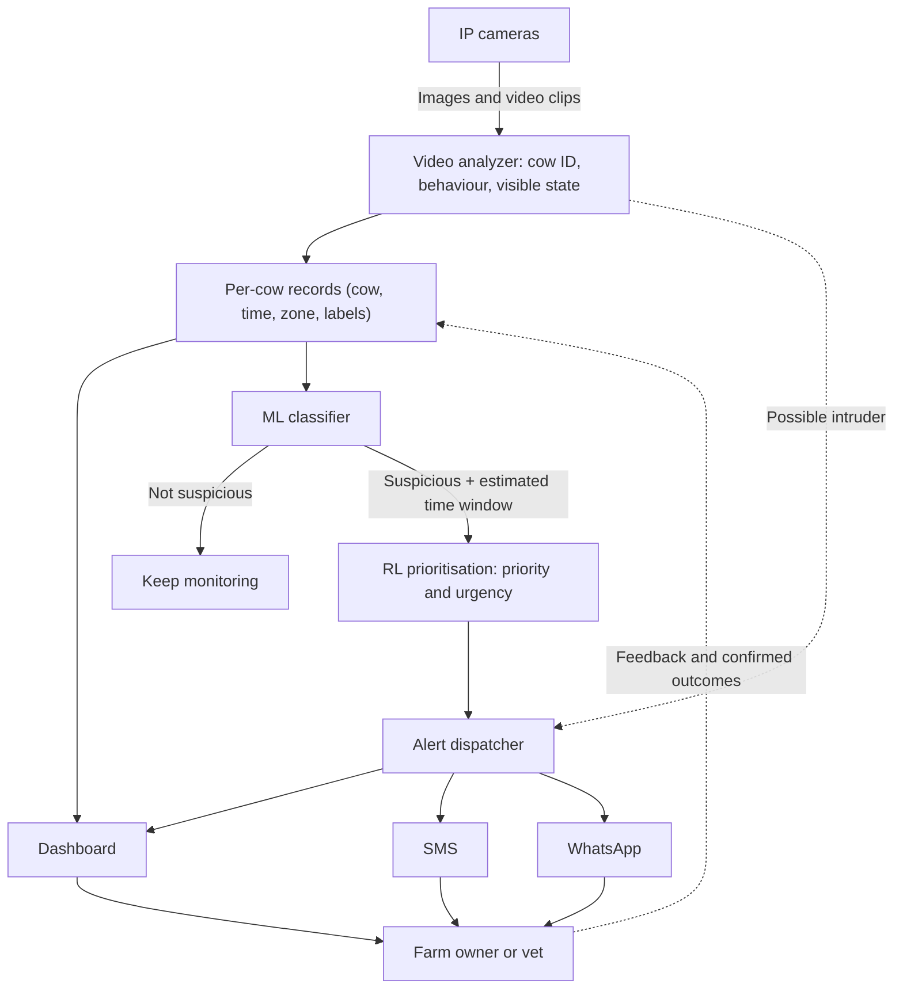

# FarmPulse AI

FarmPulse AI is a proposed cow monitoring system. It uses camera images and video to create a time-stamped record for each cow, identify changes in behaviour or visible state, flag cows that may be getting sick, prioritise them, and alert the farm owner or veterinarian through the dashboard, SMS, or WhatsApp.

The first milestone is a reproducible prototype: collect and label a small video dataset, train baseline vision models, store cow-level records, and demonstrate an alert from an end-to-end test. The suspicion classifier and the reinforcement learning (RL) prioritisation module require verified outcomes and feedback before their performance can be evaluated.

> **Current stage:** vision only. Audio and speech analysis have been removed from this stage and are listed under [Future work](#future-work).

## Project idea

Repeated observations can reveal changes that are easy to miss during periodic checks. FarmPulse AI analyses camera footage, links each observation to a cow and a time, stores the resulting records, and uses their history to separate cows that look normal from cows that may need attention. Suspicious cows are ranked by priority and an estimated time window, and the owner is alerted.

The system supports human decisions. A suspicion flag, priority, or estimated time window is not a diagnosis.

## Scope

### In scope

- Capture images and video clips from IP cameras with farm, camera, and zone metadata.
- Detect cow behaviour and visible state from video, including movement, feeding, lying, posture, and observable signs such as an open mouth.
- Associate observations with a cow and a timestamp, then save a record for each cow.
- Show all records, cow status, and reports on a dashboard.
- Use current and historical records to classify each cow as **suspicious** or **not suspicious** for a defined health outcome, with an estimated time window.
- Pass suspicious cows to an RL model that assigns a priority and urgency level.
- Send alerts to the owner or veterinarian through the dashboard, SMS, and WhatsApp.
- Route possible intruders to a separate immediate security alert.
- Produce a weekly summary for the dashboard.
- Collect owner or veterinarian feedback on alerts and outcomes to improve later versions.

### Outside the initial prototype

- Audio, vocalisation, or speech analysis (see [Future work](#future-work)).
- Autonomous treatment, medication, or veterinary diagnosis.
- A claim that illness or death can be predicted accurately before labeled outcomes and a held-out evaluation exist.
- Deployment across multiple farms, fully automated cow identification, or a production-grade dashboard.

## System architecture



The project has four main modules:

| Module | Input | Output | Responsibility |
| --- | --- | --- | --- |
| **1. Video analyzer** | Camera images and video clips | Cow ID or track, behaviour and state labels, security event, confidence, time | Run behaviour (CV-M1), visible state (CV-M2), and security/intruder (CV-M3) detectors. |
| **2. Records and dashboard** | Analyzer outputs | Per-cow records, dashboard views, weekly reports | Align observations by cow, zone, and time; store them; show records, flags, and alerts. |
| **3. ML suspicion classifier** | Per-cow records and history | Suspicious / not suspicious flag, estimated time window, confidence | Start with transparent rules; train a supervised classifier once verified outcomes exist. |
| **4. RL prioritisation and alerts** | Suspicious cases, cow history, classifier output, feedback | Priority, urgency level, suggested action, alert | Rank suspicious cows, propose a response for human review, and send alerts via dashboard, SMS, and WhatsApp. |

### Record flow

1. **Capture.** IP cameras produce images and video clips tagged with farm, camera, zone, and time.
2. **Analyse.** The video analyzer identifies or tracks each cow and labels its behaviour and visible state. Possible intruders are routed straight to the alert dispatcher as a security alert, separate from health observations.
3. **Record.** Observations are aligned by cow, zone, and time, and one record is saved per cow per observation interval. Cows that cannot be identified reliably are kept as unassigned observations.
4. **Dashboard.** All records are available on the dashboard, together with cow status, alerts, and weekly reports.
5. **Classify.** The ML classifier reads each cow's current and historical records and labels it **suspicious** or **not suspicious**. Suspicious cows also receive an estimated time window for the target outcome (for example, a vet-confirmed condition within the next 24 to 72 hours). Non-suspicious cows continue to be monitored.
6. **Prioritise.** The RL model takes the suspicious cases, the classifier's estimate, and cow history, and assigns a priority and urgency level along with a suggested response (for example: observe again, request a check, or call a veterinarian).
7. **Alert.** The alert dispatcher sends the prioritised alert to the owner or veterinarian on the dashboard, by SMS, and by WhatsApp. Higher-priority cases can use more channels or shorter repeat intervals.
8. **Feedback.** The owner or veterinarian confirms or rejects the alert and records the outcome. This feedback is stored and used to evaluate and improve the classifier and the RL policy.

> **Why the time estimate comes from the classifier:** estimating how soon illness may appear is a supervised prediction (for example, a time-to-event model trained on confirmed outcomes). RL is better suited to deciding *what to do and how urgently* given that estimate. Keeping the two separate makes each one easier to evaluate.

### Logical data stores

| Data store | Purpose |
| --- | --- |
| `cow_profiles` | Cow identity, latest status, and latest priority. |
| `cow_observations` | Time-stamped vision records and associated labels. |
| `predictions` | Classifier output (suspicious flag, estimated time window, confidence) per cow and time. |
| `alerts` | Priority, urgency, suggested action, channels used, delivery status, and acknowledgement. |
| `feedback_outcomes` | Owner or vet feedback and confirmed health outcomes. |
| `weekly_reports` | Aggregated weekly findings for the dashboard. |

Raw observations, predictions, alerts, and confirmed outcomes are stored separately so it remains clear what was measured, what was predicted, and what was confirmed.

### Example records (illustrative schema)

Observation:

```json
{
  "farm_id": "farm-01",
  "cow_id": "C104",
  "observed_at": "2026-09-26T18:00:00Z",
  "zone": "feeding-area",
  "camera_id": "camera-03",
  "vision": {
    "behaviour": "lying",
    "state": ["mouth_open"],
    "confidence": 0.88
  },
  "source_refs": ["camera-03/clip-001"]
}
```

Prediction and alert:

```json
{
  "cow_id": "C104",
  "predicted_at": "2026-09-26T18:05:00Z",
  "classifier": {
    "suspicious": true,
    "target_outcome": "vet_confirmed_illness",
    "estimated_window_hours": 48,
    "confidence": 0.71
  },
  "rl_decision": {
    "priority": "high",
    "suggested_action": "request_vet_check"
  },
  "alert": {
    "channels": ["dashboard", "sms", "whatsapp"],
    "status": "sent",
    "acknowledged_by": null
  }
}
```

The values above are examples, not model results.

## Proposed project tasks

### 1. Define the problem and data contract

- [ ] Choose the first target outcome, its prediction window, and its ground-truth source (for example, a veterinarian-confirmed condition within the next 24 to 72 hours).
- [ ] Define cow IDs, camera zones, timestamps, observation records, prediction fields, alert fields, outcome labels, and feedback fields.
- [ ] Decide how to handle a cow that cannot be identified.
- [ ] Agree with farm staff on priority levels, alert channels, alert frequency, and permitted response options.

### 2. Collect and label data

- [ ] Capture timestamped images and video with farm, camera, and zone metadata.
- [ ] Record cow identity where reliable; retain uncertain cases as unassigned.
- [ ] Write a labeling guide for behaviour, visible state, and verified health outcomes.
- [ ] Label an initial dataset and review a subset with a second annotator or domain expert.
- [ ] Secure and back up raw media; keep a manifest of clips and labels.

### 3. Prepare and inspect the dataset

- [ ] Clean corrupt clips, align camera clocks, and handle missing or low-quality footage.
- [ ] Split train/validation/test sets by cow and collection period to reduce leakage; keep the test set untouched during model selection.
- [ ] Inspect class balance, night footage, occlusion, multiple cows in frame, and lighting changes.
- [ ] Make preprocessing reproducible with scripts and dataset version information.

### 4. Build the video analyzer

- [ ] Start with a small set of well-defined behaviour and visible-state labels.
- [ ] Add cow identification or tracking within a camera zone.
- [ ] Add a security/intruder detector and route its events separately from health observations.
- [ ] Train or adapt a baseline video model.
- [ ] Report per-class precision and recall, confusion matrices, and failure examples.
- [ ] Save model weights, preprocessing settings, label definitions, and test results.

### 5. Create records and the dashboard

- [ ] Run inference on a short video sample.
- [ ] Associate outputs by cow and time; write one record per cow per observation interval.
- [ ] Show records, cow status, and alerts on a basic dashboard.
- [ ] Generate a seven-day report and display it on the dashboard.

### 6. Build the suspicion classifier

- [ ] Aggregate observation history into features, including trends (for example, reduced feeding or longer lying time) and missing-data indicators.
- [ ] Start with transparent rules; train a supervised classifier only when verified outcomes and enough examples are available.
- [ ] Output a suspicious / not-suspicious flag with an estimated time window and confidence.
- [ ] Measure recall, false-alert rate, and lead time on held-out cows or periods; choose thresholds with a domain expert.

### 7. Prototype RL prioritisation

- [ ] Define the **state** from recent observations, history, classifier output, and relevant farm context.
- [ ] Restrict **actions** to approved options, such as priority level and suggested response (observe again, request a check, escalate to a veterinarian).
- [ ] Define **reward** from confirmed outcomes and the costs of missed cases, false alarms, late alerts, and unnecessary interventions.
- [ ] Gather logged decisions and follow-up results; compare the RL policy against a simple fixed rule (for example, rank by classifier confidence) in retrospective or simulated evaluation.
- [ ] Require human approval for real-world actions. Do not allow online self-training from unverified alerts.

### 8. Alerts and integration

- [ ] Build an alert dispatcher that sends alerts to the dashboard, SMS, and WhatsApp, with priority-based channel rules.
- [ ] Record delivery status and acknowledgement for each alert; avoid duplicate or excessive alerts.
- [ ] Expose model inference through documented interfaces.
- [ ] Connect capture, analysis, records, classification, prioritisation, alerts, and feedback collection.
- [ ] Show one traced example from raw clip to saved record, suspicion flag, priority, alert, and recorded outcome.
- [ ] Document setup, dependencies, dataset access, and how to reproduce the evaluation once implementation exists.

## Milestones

| Milestone | Completion criterion |
| --- | --- |
| **M1: Data foundation** | Labeled, versioned video sample data and a documented record schema. |
| **M2: Vision baseline** | Video analyzer evaluated on a held-out set. |
| **M3: End-to-end prototype** | Cow-linked records, dashboard, an evaluated suspicion baseline, and a demonstrated alert via dashboard, SMS, and WhatsApp. |
| **M4: Prioritisation research** | RL formulation, feedback data, offline evaluation, and human-reviewed priorities. |

## Future work

- Add microphones and an audio model to classify distress vocalisations, and combine them with visual signs (such as an open mouth) to strengthen stress indications.
- Extend to multiple farms and more automated cow identification.
- Improve the dashboard toward production quality.

## Repository status

This README describes the proposed design and work plan. Tasks are checked off only after code, data documentation, and evaluation results are added to the repository. Architecture examples and sample values above are illustrative, not reported model results.
